# Backstage

**A Claude Code mod that shows what is running behind the scenes: every subagent and background task of the session, with a little pixel mascot, what it is doing and for how long.**

When Claude starts a subagent, runs a shell command in the background or arms a monitor, Backstage puts a compact line above the prompt. Press it, and the Backstage pane lists each piece of work: who it is, what it is doing right now, how long it has been at it, and how it ended.





> The images are illustrations drawn from the mod's own pixel art (see `scripts/docs-images.py`), not screenshots of the app.

## What it shows

- **A compact line above the prompt** while work runs (and for 30 seconds after the last piece ends): up to five mascots, how many pieces are running or waiting, and the latest news. Press **Details ›** for the pane.
- **The Backstage pane**, opened by itself when a piece of work starts (unless you closed it while work was running), or with `/backstage`:
  - one row per piece of work: the mascot, its title, the time it has run, its status and current step, and a short sign of progress (tool calls made by a subagent, a running bar for a shell, events seen by a monitor);
  - `⌄` opens the last three steps and, for a subagent, **Open transcript**;
  - more than four pieces running at once: one line each, so the list stays readable;
  - **Finished**: the five most recent, with **Show all** and **Clear**.
- **Mascots**:
  - a subagent is a small pixel robot that walks while it works, looks around while it waits, waves when it is done, gets dizzy when it fails and slumps when it is stopped;
  - a background shell or monitor is a pixel screen: a shell cycles `>_ {} <> I/O`, a monitor shows a pulse, then a tick, a `!` or a dash when it ends.



Light and dark themes both work. On the terminal the mascots become `✻` and `▣`.

## Install

Backstage needs a Claude Code build with mods (function hooks). It was built and tested on Claude Code 2.1.309.

At the prompt of a terminal session:

```
/plugin install backstage --marketplace cyan119x/claude-code-backstage
```

From a shell:

```bash
claude plugin install backstage --marketplace cyan119x/claude-code-backstage
```

In the desktop app, where `/plugin` does not run: click **+** next to the prompt box, then **Plugins**, **Add marketplace** with `cyan119x/claude-code-backstage`, then **Add plugin**.

A session that was already open picks the mod up after `/reload-plugins`.

## Optional: Clawd instead of the robot

Clawd, Claude's mascot, belongs to Anthropic, so this repository ships none of his artwork. If the Claude desktop app is installed on your Mac, you can read his sprites from your own copy of the app and use him for your subagents (running types on a laptop, waiting looks around, done waves, failed is dizzy, stopped is disappointed):

```bash
git clone https://github.com/cyan119x/claude-code-backstage.git
cd claude-code-backstage
python3 scripts/sprites.py clawd
claude plugin marketplace add "$PWD"
claude plugin install backstage@claude-code-backstage --scope user
```

`scripts/sprites.py clawd` rewrites `hooks/sprites.ts` in your local copy only. Keep that copy to yourself and do not publish it. If a new app release moves the sprites, the script stops with a message and leaves the robot in place; `python3 scripts/sprites.py default` brings the robot back at any time.

## How it works

Backstage only listens; it runs no commands of its own, makes no network calls and never asks the model anything.

| What | Where it comes from |
| - | - |
| A subagent starts | `agent.spawn` (its id, description and type) |
| What a subagent is doing | `tool.call` events that carry its `agentId` |
| A subagent ends | `turn.complete` with its `agentId`, checked each second against `$.agent.list()` |
| A background shell or monitor starts | the `backgroundTaskId` / `taskId` in the Bash or Monitor result |
| It ends, or a monitor reports | the task notification (`prompt.submit` with origin `task-notification`) |
| Nothing missed | the in-flight list at each stop (`classic.Stop`), whose notification may still correct a guess |

The line above the prompt keeps every other mod's card: it follows a small **band-stack** convention, so mods that adopt it keep one order whatever order Claude Code nests their hooks in. Each mod reads what the mods beneath drew, opens a `Box` keyed `band-stack`, adds its own keyed card and sorts by rank (`handoff` 10, `backstage` 20, unknown cards 50, `ember` 90; lower is higher on screen). See `stackPieces` and `rankOf` in `hooks/register.tsx`.

## Limits

- Claude Code's own **Background tasks** panel stays: a mod can add a view, not replace or hide the built-in one.
- There is no **Stop** button yet. Stop a task from Claude Code's Background tasks panel, with `/tasks` in a terminal, or by asking Claude.
- A shell has no percentage: Claude Code does not report one, and most commands never print their progress.
- Work that started before the mod loaded shows up at the next stop of a turn.
- A subagent's time is wall-clock time from its start; tokens and model are not shown.

## Development

```
.claude-plugin/plugin.json       the mod's manifest
.claude-plugin/marketplace.json  makes this repository installable with one line
hooks/register.tsx               events, state, the line above the prompt and the pane
hooks/art.ts                     the mascot, the task screen and the running bar as SVG (SMIL animation)
hooks/sprites.ts                 the mascot animations, generated by scripts/sprites.py
types/index.d.ts                 the state contract
tests/backstage.test.tsx         tests run by `claude plugin test`
scripts/sprites.py               builds hooks/sprites.ts (the robot, or Clawd from your own app)
scripts/docs-images.py           draws the README images
```

```bash
claude plugin validate .
claude plugin test .
```

To try a change live, run `claude --plugin-dir .` from the repository, or install from the local folder as shown in the Clawd section; `/reload-plugins` picks up edits.

## License

MIT for the code and the robot artwork in this repository; see [LICENSE](LICENSE).

Backstage is an independent community mod. It is not made or endorsed by Anthropic. Claude, Claude Code and Clawd are Anthropic's.
